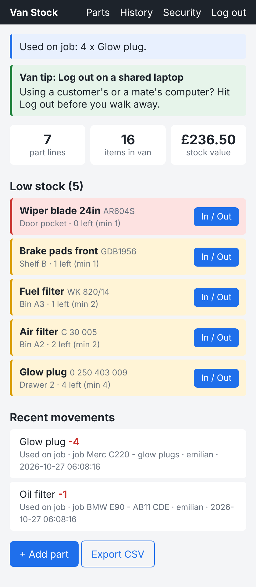
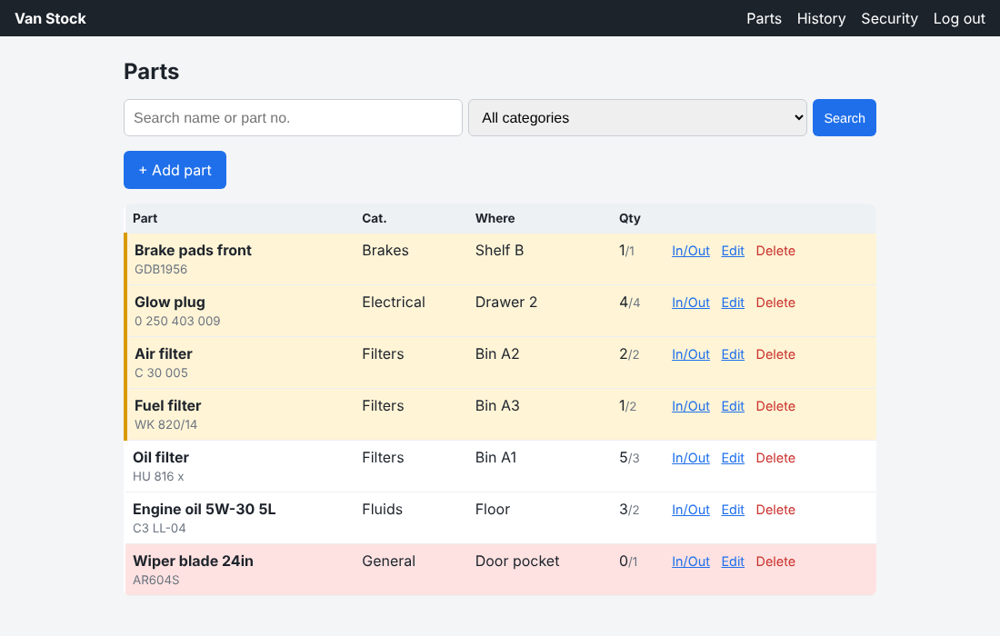
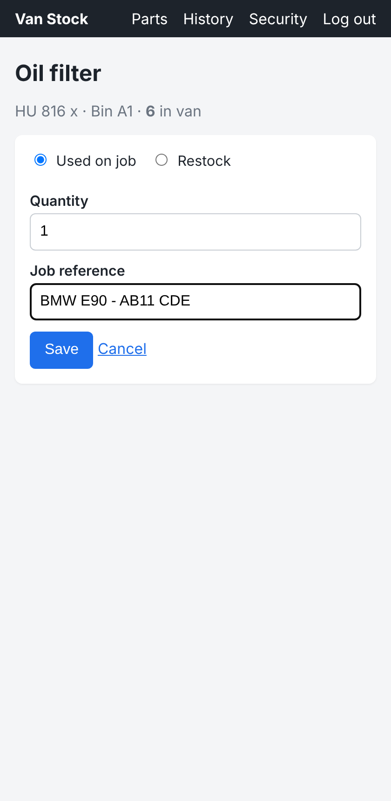
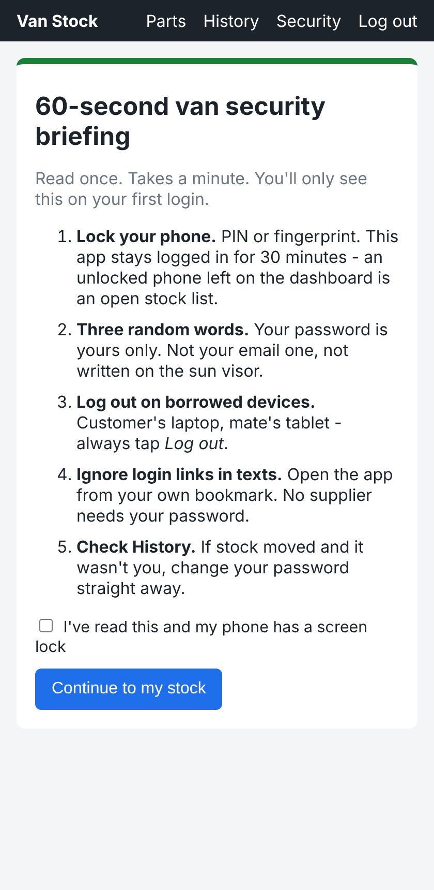

# Van Stock Tracker

A small web app for a mobile mechanic to keep track of the spare parts carried in the van: what's there, where it is, what's running low, and which job each part went on.

Built for the PFD200 Professional Development mini-project (FdSc Computing).



## Why

As a mobile mechanic I kept turning up to jobs and finding I'd used the last oil filter or glow plug the week before. Paper lists in the door pocket didn't get updated. This app is the simplest thing that fixes that: book a part out against a job, get warned when it hits the minimum level.

## Features

- Single owner login (registration closes once the account exists)
- Parts list with search and category filter
- Add / edit / delete parts (name, part number, category, location in van, quantity, minimum level, unit cost)
- Book stock **out** against a job reference (reg plate or invoice no.) or **in** when restocking
- Dashboard with low-stock / out-of-stock warnings, stock value and recent movements
- Full movement history
- CSV export (for ordering or accounts)
- Built-in security awareness campaign: first-login 60-second briefing, daily "Van tip", Security page

## Tech stack

| Part | Choice |
|------|--------|
| Language | Python 3.10+ |
| Web framework | Flask 3 |
| Database | SQLite (built into Python) |
| Front end | Jinja2 templates, plain CSS, a few lines of JS |
| Tests | pytest |
| Editor / VCS | VS Code, Git, GitHub |

## Run it locally

```bash
git clone https://github.com/emilianmarian1984-commits/van-stock-tracker.git
cd van-stock-tracker
python -m venv .venv
# Windows: .venv\Scripts\activate    macOS/Linux: source .venv/bin/activate
pip install -r requirements.txt

flask --app vanstock init-db        # creates instance/vanstock.sqlite
flask --app vanstock seed-demo      # optional: adds 7 example parts
flask --app vanstock run --debug
```

Open http://127.0.0.1:5000, create the owner account, log in.

### Configuration

| Variable | What it does |
|----------|--------------|
| `VANSTOCK_SECRET_KEY` | Session signing key. Set this in production. If missing, a random key is generated on every start (you'll be logged out on restart). |
| `VANSTOCK_HTTPS=1` | Marks the session cookie `Secure`. Use when hosted behind HTTPS. |

No secrets are stored in the repo. The database lives in `instance/`, which is git-ignored.

## Tests

```bash
python -m pytest -v
```

19 tests cover login, password rules, lockout, access control, CSRF, security headers, validation, stock in/out rules, low-stock logic, SQL injection, XSS escaping and CSV formula injection.

## Security measures

| Threat | Mitigation in the code |
|--------|------------------------|
| Password guessing | 12+ char rule, common-password list, lockout for 15 min after 5 fails, same error for unknown user/wrong password |
| Stolen database | Passwords hashed with Werkzeug (scrypt) |
| SQL injection | All queries parameterised (`?` placeholders) |
| XSS | Jinja2 auto-escaping + Content-Security-Policy (no inline scripts) |
| CSRF | Synchroniser token on every POST form |
| Session hijack / fixation | HttpOnly + SameSite cookies, session cleared on login, 30-min lifetime |
| Clickjacking | `X-Frame-Options: DENY` |
| CSV formula injection | Cells starting with `= + - @` are prefixed with `'` on export |

The risks that code can't fix (unlocked phone, password reuse, phishing texts, shared laptops) are handled by the security awareness campaign inside the app - see `stock.py` (`VAN_TIPS`) and `templates/stock/briefing.html`.

## Database

```
users      (id, username, password_hash, failed_attempts, locked_until, briefing_done, created_at)
parts      (id, name, part_number, category, location, quantity, min_quantity, unit_cost, created_at)
movements  (id, part_id -> parts, user_id -> users, change, reason, job_ref, created_at)
```

`quantity` has a `CHECK (quantity >= 0)` so stock can't go negative even if the app logic had a bug.

## Limitations

- One user only - fine for a sole trader, not for a garage with staff.
- No barcode scanning; parts are typed in.
- Not hosted - runs locally. A free host (e.g. PythonAnywhere) would work but wasn't set up in the time available.
- No supplier ordering or price lookup.
- No offline mode; needs signal if hosted.

## Screenshots

| Dashboard | Parts | Book out | Briefing |
|---|---|---|---|
|  |  |  |  |
